# StudyDeck

StudyDeck is a React Native app (Expo + Expo Router). It keeps all of a university student's assignments, quizzes, projects and exams in one place, so nothing gets forgotten and the most urgent work is always at the top.

- **Users:** university students taking several courses at once (for example, a Haigazian student with five courses).
- **Problem:** deadlines are scattered across Moodle, syllabi, WhatsApp groups and class announcements, so it is easy to miss a due date or notice too late that a heavily weighted exam is coming.
- **Solution:** one searchable, filterable list of coursework. Each item has a course, a due date, a grade weight and a status, and the list stays on the phone after the app is closed.

CSC 0279 Mobile Application Development · Project 1 (individual)

---

## Mock login credentials

| Email | Password |
|---|---|
| `student@studydeck.com` | `study2026` |

The login screen also shows these credentials in a "Demo account" box.

---

## Setup and running

Requirements: Node.js 20 or later, npm, and the **Expo Go** app on a phone (or an Android emulator / iOS simulator).

```bash
# 1. Install dependencies (uses package-lock.json)
npm install

# 2. Start the development server
npx expo start
```

Then scan the QR code with Expo Go (Android) or the Camera app (iOS). Press `a` to open an Android emulator or `i` to open an iOS simulator.

**Tested with:** Expo Go on **[Android / iOS — fill in your phone model and OS version]**. Expo SDK 58 and Expo Router 58. Every library used (including `@react-native-async-storage/async-storage` 2.2.0) is bundled in Expo Go, so no development build is needed.

> The first launch loads 8 sample items. After that, the app always loads what you saved. To start over with the sample data, clear the Expo Go app's storage or uninstall and reinstall the project in Expo Go.

---

## Implemented features

**Navigation (Expo Router, Stack)**
- Welcome → Login → My Coursework. Both steps use `router.replace`, so Back cannot return to Welcome or Login after logging in.
- My Coursework → Details (`/details/[id]`) → Edit (`/edit/[id]`); My Coursework → Add (`/add`); My Coursework → Profile (person icon in the header).
- Log out (on Profile) calls `router.dismissAll()` and then `router.replace("/login")`. The app screens are wrapped in `Stack.Protected` and can only be opened while logged in.
- Back always goes to the previous logical screen. Saving an edit returns to Details, and deleting returns to the list.

**Coursework management**
- 8 realistic mock items across 4 courses, with mixed types, statuses and due dates in November and December 2026.
- List cards show the title, course, type, weight, due date, a status badge and a days-left label. Items due within 3 days or overdue are highlighted in red.
- Summary counts for To do, In progress and Done.
- **Search** by title or course name, plus **status filter** chips (All / To do / In progress / Done).
- **Details** screen with a countdown, all fields and notes.
- **Add** and **Edit** use the same `CourseworkForm` component. Edit opens with the current values filled in.
- **Delete** asks for confirmation in a `ConfirmDialog` first.
- Quick status button on Details (To do → In progress → Done → reopen).
- Profile shows the mock student, a progress bar, counts per status and the next deadline.

**Validation (Zod)**
- `src/validation/loginSchema.js`: email is required and must be valid; password is required and must be at least 6 characters. Valid input is then compared with the predefined account in `src/data/mockUser.js`.
- `src/validation/courseworkSchema.js`: title and course are required (80 characters max); type and status must be one of the allowed values; the due date must be a real `YYYY-MM-DD` date (so `2026-02-30` is rejected); weight must be a number from 0 to 100; notes can be up to 300 characters.
- Each error is shown under its field and the field gets a red border. Invalid data is never saved.

**Persistence (AsyncStorage)**
- The whole list is stored as JSON under the key `studydeck:coursework` (`src/storage/courseworkStorage.js`).
- On startup the root layout loads the saved list while a spinner is shown. The sample data is used only when nothing has been saved yet (`null`). A saved empty list `[]` stays empty after a restart.
- Every add, edit and delete is **saved first and then applied to state**. If saving fails, the screen keeps the old data and shows an error.

**Feedback states**
- Loading spinner while saved data is read; spinner on the save, delete and status buttons while they work.
- Empty collection: "No coursework yet" with an Add button. No search results: "No matching coursework" with a "Clear search and filter" button.
- Load failure: an error message with a "Try again" button. Save or delete failure: an inline error message.
- Success banner after adding, saving, deleting or changing status.

---

## Project structure

```
src/
  app/                     ← Expo Router routes only (screens)
    _layout.jsx            root Stack, shared state, AsyncStorage load/save, login flag, feedback banner
    index.jsx              1 Welcome
    login.jsx              2 Login
    coursework.jsx         3 My Coursework (list, search, filter)
    details/[id].jsx       4 Details (status, edit, delete)
    add.jsx                5 Add item
    edit/[id].jsx          6 Edit item
    profile.jsx            7 Profile and Log out
  components/              reusable UI (outside the route folder)
    AppButton, AppScreen, AppTextInput, FormField, CourseworkCard, CourseworkForm,
    StatusBadge, StatusFilter, SearchBar, OptionPicker, EmptyState, LoadingView,
    ConfirmDialog, FeedbackBanner, InfoRow, HeaderIconButton
  constants/               colors.js, coursework.js (types, statuses, badge colours, icons)
  context/                 CourseworkContext.js (passes the layout's state to the screens)
  data/                    mockCoursework.js, mockUser.js
  storage/                 courseworkStorage.js (AsyncStorage load/save)
  utils/                   dates.js (parse, days left, labels, formatting)
  validation/              loginSchema.js, courseworkSchema.js, getFieldErrors.js
docs/
  screen-flow.png          screen-flow diagram
  screenshots/             screenshots of the main screens
```

**Where the state lives:** the coursework array is kept in `src/app/_layout.jsx`, the parent of every screen. The layout passes the data and the functions that change it (`addCoursework`, `updateCoursework`, `deleteCoursework`, `showMessage`, `logIn`, `logOut`) to the screens through `CourseworkContext`. Screens pass data and callbacks on to components through props. For example, `CourseworkCard` receives `item` and `onPress`, and `CourseworkForm` receives `initialValues`, `onSubmit` and `onCancel`. Screen-only state, such as the search text and selected filter, stays in that screen.

---

## Screen-flow diagram

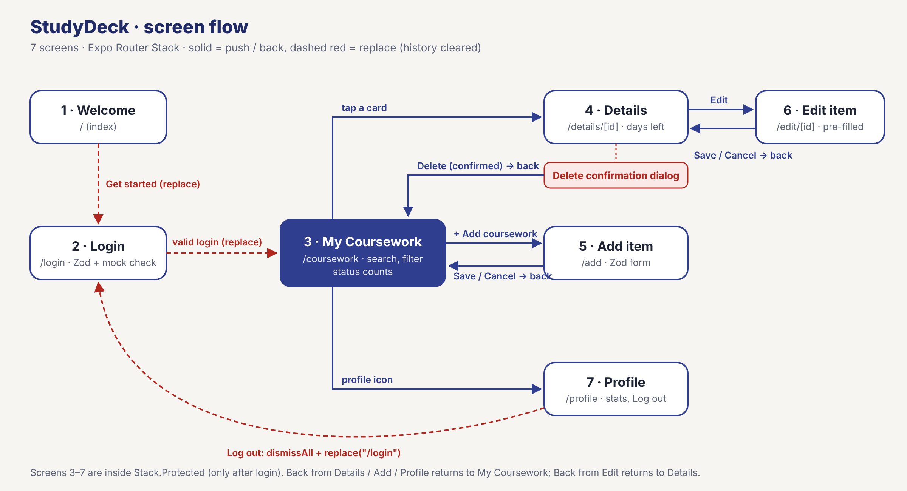

## Screenshots

| Welcome | Login validation | Wrong credentials | My Coursework |
|---|---|---|---|
| 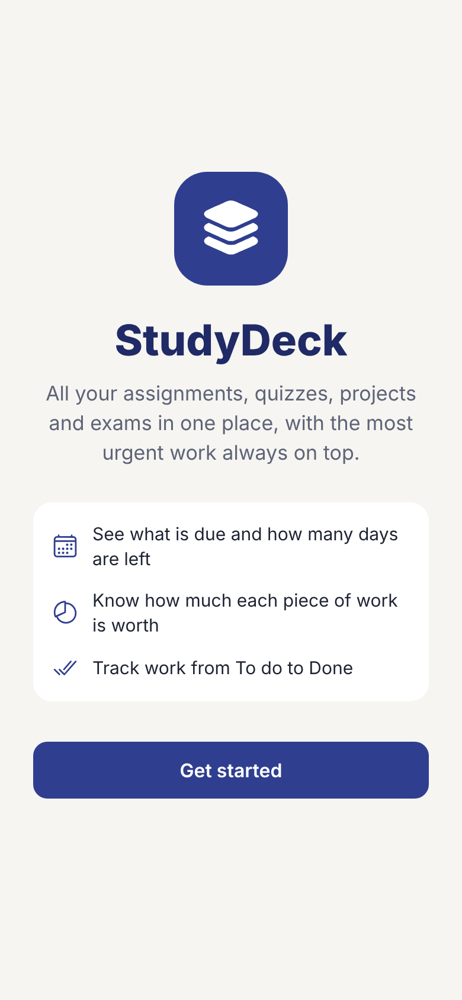 | 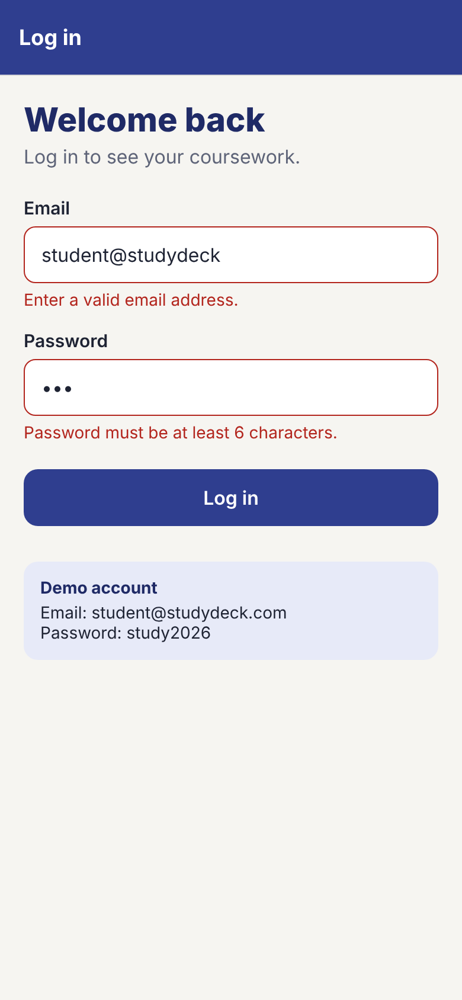 | 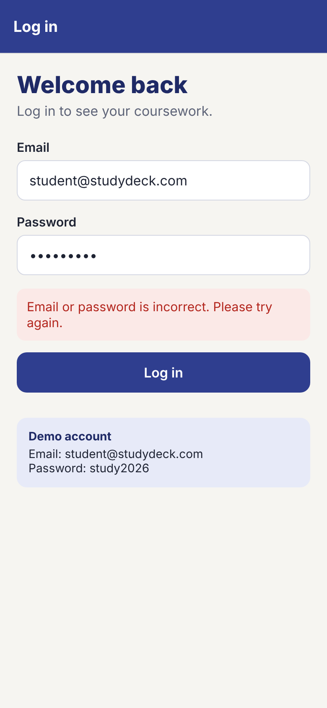 | 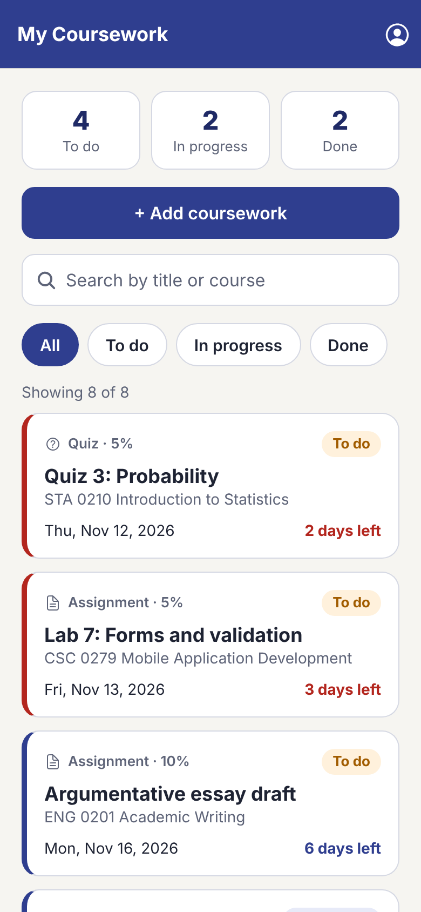 |

| Search | No results | Filter: Done | Details |
|---|---|---|---|
| 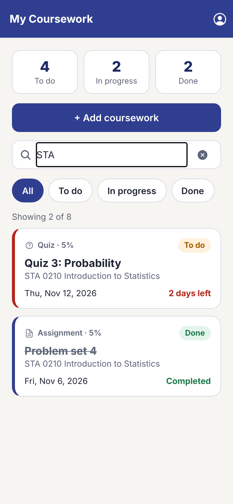 | 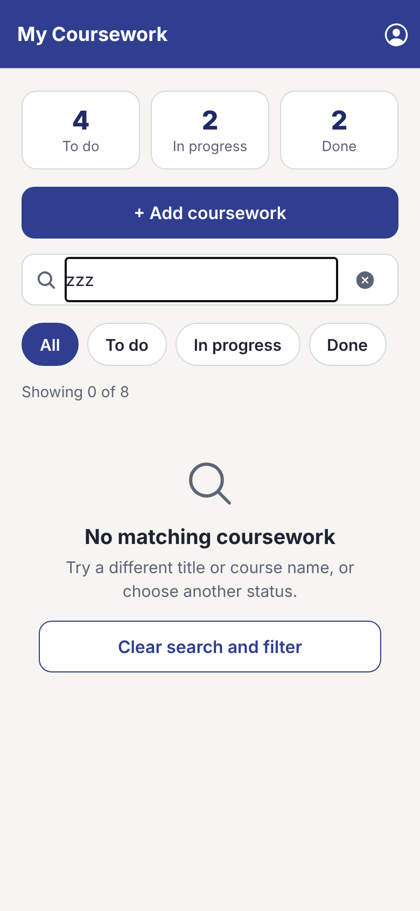 | 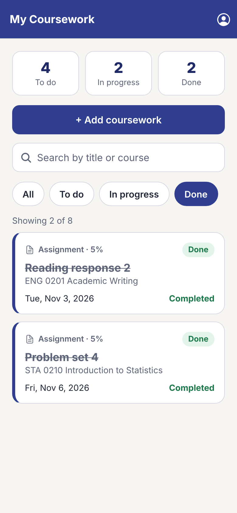 | 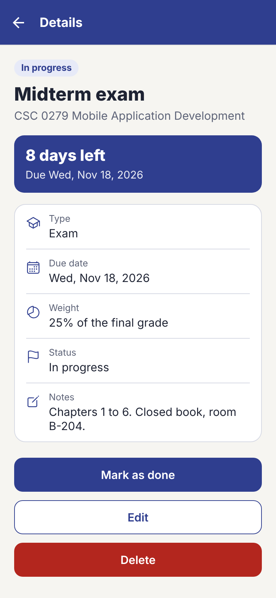 |

| Edit errors | After edit | Add item | After add |
|---|---|---|---|
| 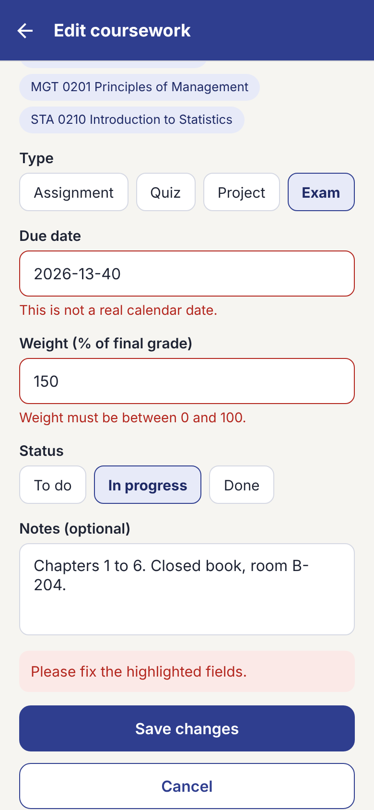 | 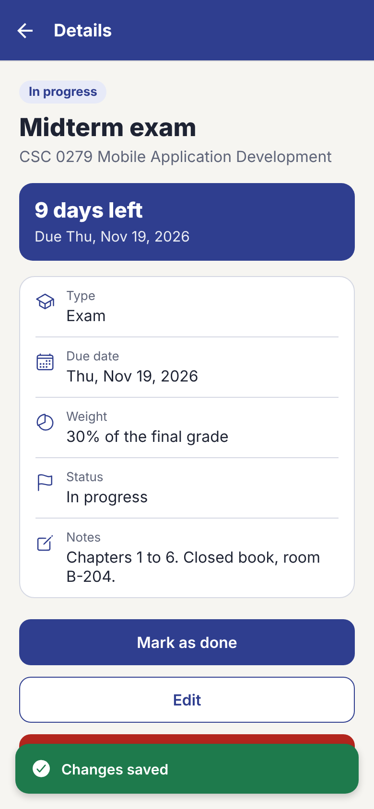 | 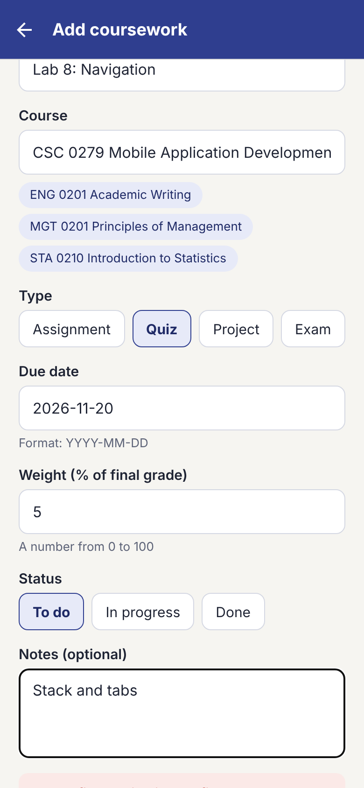 | 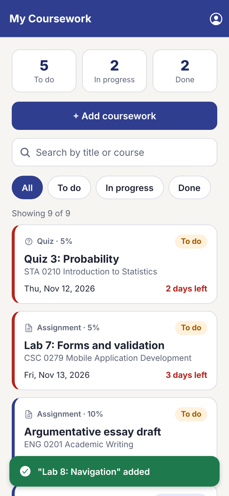 |

| Delete confirmation | After delete | Profile | Empty list |
|---|---|---|---|
| 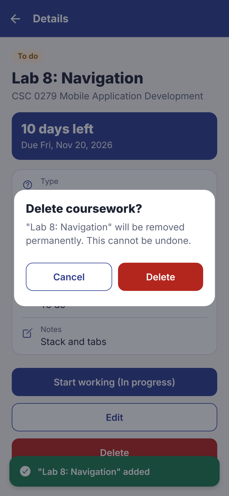 | 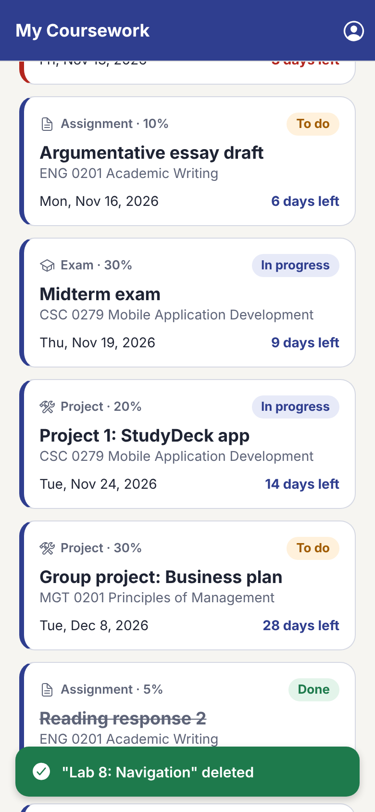 | 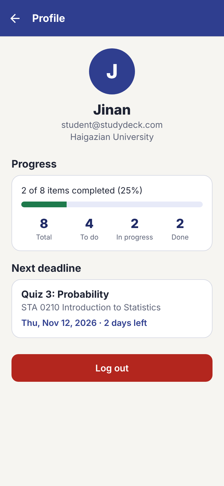 | 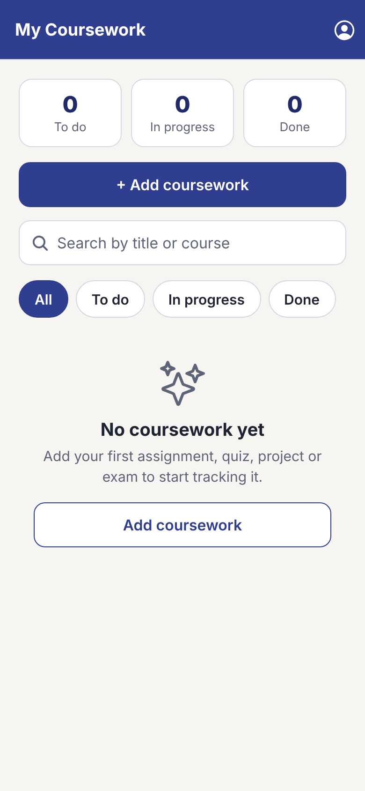 |

*These screenshots were taken from the web build at a phone-sized viewport. Replace them with screenshots from your own device if you prefer.*

---

## Known limitations

- **Mock authentication only.** There is a single hard-coded account and no real security. The logged-in flag is kept in memory, so you log in again after every restart. Your coursework data does persist.
- **The due date is typed as text** (`YYYY-MM-DD`) rather than picked from a native date picker. Zod checks that it is a real date.
- **No reminders or notifications** for upcoming deadlines.
- **One device only.** Data lives in AsyncStorage on the phone, with no backend or sync (planned for the final project).
- **No undo** after deleting. The confirmation dialog is the safeguard.
- Course names are free text. Quick-pick chips help keep them consistent, but courses are not managed separately.
- The app targets phones in portrait orientation. It runs on the web for testing, but web is not a supported platform.

---

## AI-use statement

> **Edit this section so it describes honestly how you used AI.** The draft below is a starting point.

I used an AI coding assistant for this project. Based on my approved proposal and the MyTasks examples from class, it generated a first version of the screens, components, Zod schemas, AsyncStorage logic, the screen-flow diagram and a draft of this README. I reviewed all of the code, ran and tested the app myself in Expo Go on my phone, and **[describe what you changed, fixed or added yourself]**. I can explain how each part works, including the reusable components and props, the state updates in `_layout.jsx`, and saving and restoring with AsyncStorage.

---

## Submitted version

Final submitted commit: **`<fill in the commit hash>`** (also tagged `v1.0-submission`).

Get the hash with `git log -1 --format=%H` after your last commit. The submitted ZIP is made from this commit and does not include `node_modules` or `.expo`.
